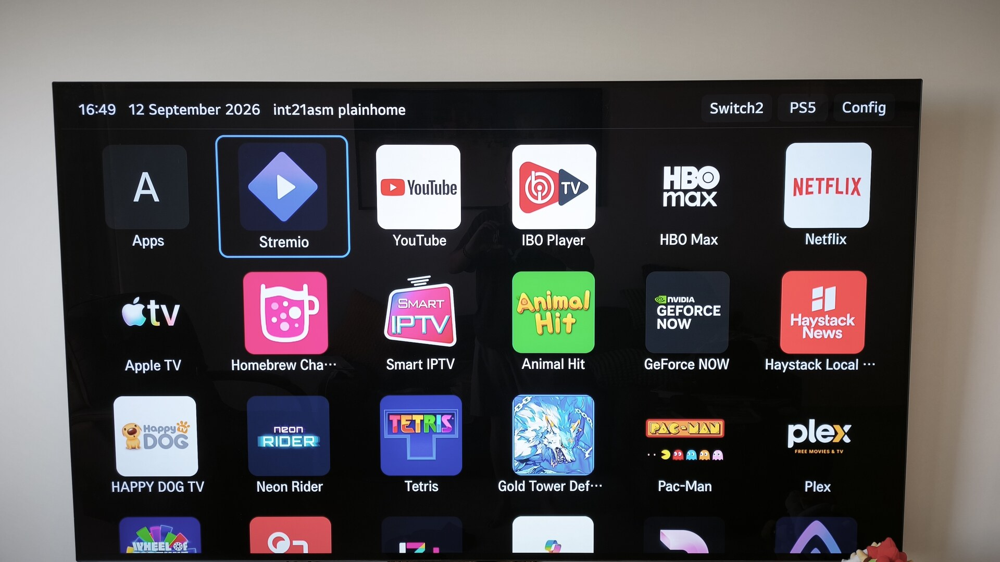

On LG TVs with a **Power On Screen** setting, choose **Recent Input** in **All Settings > General > System > Additional Settings > Home Settings** to stop LG Home from automatically opening alongside PlainHome at startup. Keep PlainHome's startup option enabled. The TV may briefly show the last input while PlainHome starts.

# PlainHome

A deliberately minimal launcher for LG webOS TVs:

- black background
- dynamically lists launchable installed apps
- large icons in a compact six-column grid
- persistent custom app order with new apps appended automatically
- Custom, LG-order, and alphabetical sorting, with a reset-to-LG-order action
- persistent hide/unhide controls for installed apps
- guarded removal of apps that webOS explicitly marks removable
- scrollable top bar with a clock, date, custom text, connected named HDMI inputs (with an input icon), and a Config menu
- independently configurable time and date formats, with an option to hide either one
- persistent focus-border and tile-background color selection; tile backgrounds default to OLED black
- optional launch at TV startup, Home-button takeover, and a learnable spare-button shortcut
- D-pad, Enter, Back, Magic Remote pointer and wheel scrolling



## Requirements

PlainHome currently requires a **rooted webOS TV with Homebrew Channel installed and its root service enabled**. Installing the IPK through LG Developer Mode on an unrooted TV is not sufficient: application discovery, icon access, connected-input detection, and app removal depend on rooted Homebrew services.

Unrooted TVs are not supported by the current release.

## Tested on

PlainHome has been developed and tested on:

| TV | webOS core release | Firmware |
| --- | --- | --- |
| LG OLED B3 (`OLED77B36LA`) | `10.3.1-3001` | `33.31.61` |
| LG UP75 (`55UP7550PVG`) | `6.5.3-47` | `03.53.45` |

webOS 6 runs web apps on Chrome 79, so PlainHome uses ES5 JavaScript and avoids newer CSS such as flexbox `gap` and `inset`.

Other rooted LG webOS models and releases may work, but have not yet been verified.

## Build

Install LG's official webOS CLI, then run:

```sh
npm install -g @webos-tools/cli
```

```sh
./build.sh
```

The build script uses `ares-package --no-minify`. The standard webOS IPK and
Homebrew manifest are written to `dist/`.

## Install and test

Install the IPK using webOS Dev Manager, then launch **PlainHome** from the normal launcher or Homebrew Channel.

Alternatively, run `./deploy-tv.sh`. It prompts for the TV address, SSH password and version, uploads and installs that IPK, then keeps only the two highest PlainHome IPK versions in the TV's `/tmp`. Values may also be supplied through `TV_HOST`, `TV_USER`, and `TV_PASSWORD` environment variables.

The app first requests the catalog directly. On firmware that blocks the request, it uses the rooted Homebrew Channel's documented `/exec` helper once to register the narrow Luna permissions required by this app. It creates `com.github.int21asm.plainhome.app.json` in the TV's existing Luna client-permissions directories, rescans Luna manifests, and restarts only PlainHome. It does not modify system application files.

Because webOS blocks one app from reading another app's icon, the Homebrew helper also runs the bundled `icon-copy.js`. That helper accepts only icon files contained in known webOS application roots, limits files to 2 MB, and copies them into PlainHome's own `icons/` directory. No system-owned file is changed.

Starting that helper takes about two seconds on older TVs, so PlainHome keeps the copied icon paths in its local storage. After the first run the grid is drawn immediately from that cache, the helper refreshes it in the background, and only tiles whose icon changed are redrawn. Copied icons have stable names (app ID plus the source file's size and modification time), so unchanged icons are not copied again.

The startup, Home-button, and remote-shortcut features are disabled until enabled in Config. Enabling any of them creates `/var/lib/webosbrew/plainhome.conf` and a `60-plainhome` symlink in `/var/lib/webosbrew/init.d/` to PlainHome's packaged startup script.

### Startup and Home-button hook

The startup option subscribes to webOS power-state changes; it does not poll continuously. At a full boot it launches PlainHome with bounded retries, stopping as soon as webOS confirms a successful launch. On a real suspend-to-active transition it launches PlainHome again. Screen-saver transitions are ignored so watching a video does not unexpectedly return to the launcher.

Select **TV Settings** in the top bar to open LG's native settings. Use **Config** for PlainHome preferences.

The Home-button option starts a read-only Linux input watcher as root. It:

- opens the available `/dev/input/event*` devices as non-blocking readers
- checks for key-down events every 100 ms
- recognizes the Home key code observed on both tested TVs (`773`)
- debounces repeated presses for 1.2 seconds
- asks webOS Application Manager to launch PlainHome
- retries only when webOS does not confirm the launch

To keep LG Home from opening first, the watcher sets the webOS configuration value `com.webos.surfacemanager.disableHome` to `true` through `luna://com.webos.service.config/setConfigs`. The system UI checks this value before launching LG Home on a Home press, so the key reaches only PlainHome. The value is set only while the Home option is on and the watcher can read at least one input device. It is not saved by webOS, and the watcher resets it when it is stopped, exits on an error or is turned off in Config. A reboot always gives the Home button back to LG Home until the startup hook runs again. If the value cannot be set, the watcher falls back to waiting 350 ms before launching PlainHome, and LG Home may appear briefly.

The watcher does not grab the input device, patch `lginput2`, modify system files, or inject code into an LG process. The fixed Home key code can differ on an untested TV or webOS release.

The learned remote shortcut uses the same watcher, so enabling both Home and a shortcut does not create a second polling loop. PlainHome asks the user to press the desired button, records the exact Linux key code emitted by that remote, and stores it in `/var/lib/webosbrew/plainhome.conf`. This avoids a model-specific button list. A shortcut launch uses a shorter 100 ms delay. Because events are only observed—not blocked—the button's normal LG action still occurs; a spare color button such as Blue is recommended. Select the shortcut setting and press Yellow to clear it.

Disable every startup/input option to remove PlainHome's hook and configuration file.

## Controls

- Arrow keys: move
- Enter / remote wheel click: launch
- Hold Enter / OK: enter move mode; arrows reposition, OK saves, Back cancels
- Red button: refresh the installed-app list
- Yellow button: remove the selected app when webOS marks it removable (confirmation required)
- Back: close PlainHome
- Magic Remote pointer: point and click

The Config menu provides:

- time format: 24 hours, AM/PM, or Off
- date format: Day Month Year, Month Day, Year, DD/MM/YYYY, MM/DD/YYYY, or Off
- Custom, LG-order, and alphabetical sort modes
- custom-order reset
- focus-border color
- tile-background color, defaulting to OLED black
- optional custom header text, empty by default
- app hide/unhide controls
- optional launch at TV startup
- optional Home-button takeover
- learnable remote-button shortcut: press the desired spare button to assign it; press Yellow on this setting to clear it

## Development disclosure

OpenAI Codex assisted with development. The maintainer is responsible for reviewing, testing, and publishing the code.
